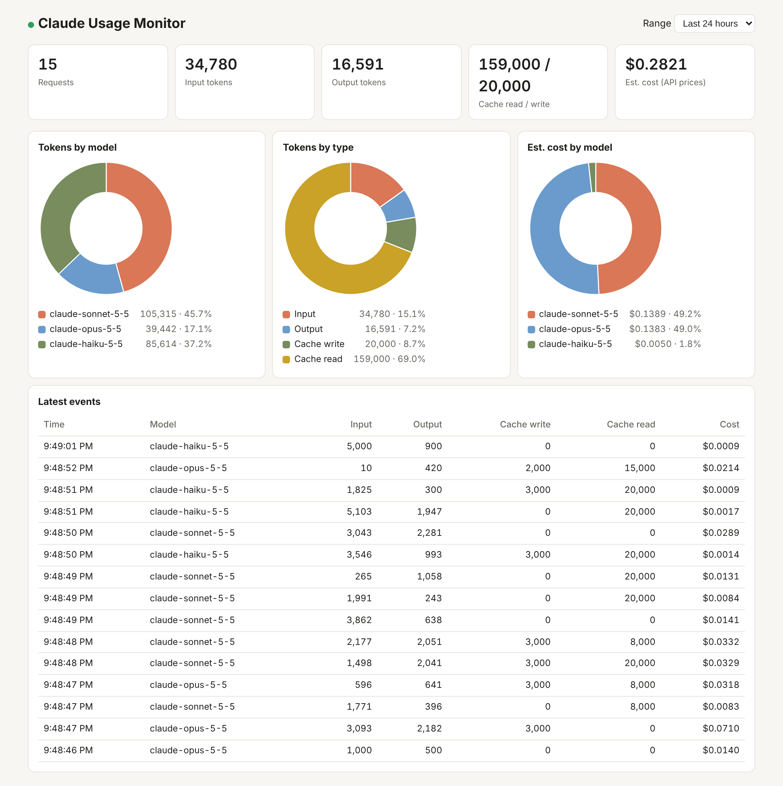

# claude-usage-monitor

What it says on the tin, live monitoring of token usage.

A small local tool that receives Claude usage (tokens, model, estimated cost),
logs every event to SQLite, and shows a live dashboard with pie charts.

- **No dependencies.** Python 3.9+ standard library only. No `pip install` to run it (the Mac app build uses PyInstaller).
- **Push, not poll.** Claude Code (or your own code) sends usage to the monitor
  over HTTP on `localhost`. Nothing leaves your machine.
- **Real time.** The dashboard updates the moment an event arrives (Server-Sent Events).
- **SQLite log.** Every event lands in `usage.db` next to the script.



## Files

| File | What it does |
|---|---|
| `app.py` | Standalone app entry point: starts the server, imports past Claude Code usage, opens the dashboard in its own window. Also acts as the hook (`--hook`). |
| `build_mac.sh` | Builds `Claude Usage Monitor.app` with PyInstaller. |
| `usage_monitor.py` | The server: HTTP endpoint, SQLite logging, dashboard. Also has `send` and `demo` commands. |
| `claude_code_hook.py` | A Claude Code hook that reads new usage from the session transcript and posts it to the monitor. |
| `env.py` | Loads settings from a `.env` file. |
| `.env.example` | Template for your `.env` (copy it, then edit). |

## Get the code

```bash
git clone https://github.com/joesterne/claude-usage-monitor.git
cd claude-usage-monitor
cp .env.example .env      # optional: only needed to change the defaults
```

## Configuration (.env)

All settings live in a `.env` file, which is git-ignored, so your local paths
and ports never get committed. `.env.example` lists every setting with its
default:

| Setting | Default | What it does |
|---|---|---|
| `USAGE_MONITOR_HOST` | `127.0.0.1` | Address the server listens on. Keep it local. |
| `USAGE_MONITOR_PORT` | `8765` | Port for the server and dashboard. |
| `USAGE_MONITOR_DB` | `usage.db` next to the script; the app uses `~/Library/Application Support/Claude Usage Monitor/usage.db` | SQLite file. |
| `USAGE_MONITOR_URL` | `http://HOST:PORT/usage` | Where the hook sends usage. |
| `CLAUDE_PROJECTS_DIR` | `~/.claude/projects` | Transcripts the app imports on launch. |
| `USAGE_MONITOR_VERBOSE` | empty | Set to `1` to log every request. |

Where `.env` is read from, first match wins per setting:

1. the file named in `USAGE_MONITOR_ENV`, if you set it
2. `.env` next to the scripts (running from source)
3. `~/Library/Application Support/Claude Usage Monitor/.env` (the Mac app)
4. `~/.claude-usage-monitor/.env`

Real environment variables always win over `.env`. The tool needs no API keys
or other secrets.

## Standalone Mac app (recommended)

Build it once:

```bash
cd claude-usage-monitor
./build_mac.sh
cp -R "dist/Claude Usage Monitor.app" /Applications/
```

The build needs `python3` on the machine. The finished app bundles its own
Python, so it runs without it.

Then double-click **Claude Usage Monitor** in Applications. It:

1. starts the local server on `127.0.0.1:8765`,
2. imports usage from every Claude Code session already on disk
   (`~/.claude/projects`), including ones that ran while the app was closed,
3. opens the dashboard in its own window. Closing the window quits the app.

The first time, click **Connect Claude Code** at the top of the dashboard.
That adds the app as a hook in `~/.claude/settings.json` (it keeps your other
settings and saves a `settings.json.bak` first). The hook command is the app
itself, `"/Applications/Claude Usage Monitor.app/Contents/MacOS/Claude Usage Monitor" --hook`,
so Claude Code doesn't need Python either. If you move the app, click the button again.

The app keeps its data in `~/Library/Application Support/Claude Usage Monitor/usage.db`.

Because the app isn't signed by an Apple developer account, macOS may warn the
first time. Right-click the app, choose **Open**, then **Open** again. You only
need to do this once.

The sections below cover running it as a plain Python script instead.

## 1. Start the monitor

```bash
cd claude-usage-monitor
python3 usage_monitor.py
```

Open **http://127.0.0.1:8765** in your browser. Leave the terminal running.

Try it with fake data (in a second terminal):

```bash
python3 usage_monitor.py demo
```

Options: `--port 9000`, `--db /path/to/usage.db`, `--host 127.0.0.1`. These
override the `.env` settings (see Configuration).

## 2. Connect Claude Code

Claude Code writes every assistant message, with its `usage` block, to a session
transcript. The hook reads only the new lines each time it runs and posts them
to the monitor. Add this to `~/.claude/settings.json` (merge it into any
`hooks` you already have, and replace `/path/to` with where you cloned the repo):

```json
{
  "hooks": {
    "PostToolUse": [
      { "matcher": "*", "hooks": [ { "type": "command",
        "command": "python3 \"/path/to/claude-usage-monitor/claude_code_hook.py\"" } ] }
    ],
    "Stop": [
      { "hooks": [ { "type": "command",
        "command": "python3 \"/path/to/claude-usage-monitor/claude_code_hook.py\"" } ] }
    ],
    "SubagentStop": [
      { "hooks": [ { "type": "command",
        "command": "python3 \"/path/to/claude-usage-monitor/claude_code_hook.py\"" } ] }
    ]
  }
}
```

- `Stop` sends usage each time Claude finishes a reply.
- `PostToolUse` sends it after every tool call, so long agentic turns show up
  live instead of only at the end. Drop it if you only want per-reply updates.
- `SubagentStop` picks up subagent work.

Restart Claude Code (or run `/hooks` to check it loaded). The hook always exits
0, so it never interrupts Claude Code. If the monitor isn't running, it keeps
its place and sends the backlog next time. Its bookmark file is
`~/.claude-usage-monitor/offsets.json`.

Claude Code writes a message's usage on several transcript lines while it
streams. The monitor de-duplicates by message id and keeps the final counts.

## 3. Send usage from anything else

POST JSON to `http://127.0.0.1:8765/usage`. The field names match the Claude
API's `usage` object:

```bash
curl -X POST http://127.0.0.1:8765/usage -H 'Content-Type: application/json' -d '{
  "model": "claude-opus-5-5",
  "source": "my-script",
  "usage": {"input_tokens": 1200, "output_tokens": 340,
            "cache_creation_input_tokens": 0, "cache_read_input_tokens": 5000}
}'
```

- Token fields can also be at the top level instead of inside `usage`.
- Optional: `message_id` (de-duplicates), `session_id`, `source`, `timestamp`, `cost_usd` (overrides the estimate).
- You can POST a JSON list to send many events at once.

From your own Python code using the Anthropic SDK, after each call:

```python
import json, urllib.request
resp = client.messages.create(...)
urllib.request.urlopen(urllib.request.Request(
    "http://127.0.0.1:8765/usage",
    data=json.dumps({"model": resp.model, "message_id": resp.id, "source": "my-app",
                     "usage": resp.usage.model_dump()}).encode(),
    headers={"Content-Type": "application/json"}), timeout=2)
```

Or from the command line:

```bash
python3 usage_monitor.py send --model claude-sonnet-5-5 --input 800 --output 200
```

## Dashboard

- Totals: requests, input, output, cache read/write tokens, estimated cost.
- Three pie charts: tokens by model, tokens by type (input / output / cache write / cache read), estimated cost by model.
- The 15 latest events.
- A range picker: last hour, 24 hours, 7 days, or all time.
- The green dot means the live connection is up.

## About the cost number

Cost is an **estimate** at Anthropic's first-party API list prices (the
`PRICING` table at the top of `usage_monitor.py`, Nov 2026). Cache writes are
estimated at 1.25x the input price. On a Claude Pro or Max subscription,
Claude Code isn't billed per token, so read it as "what this would cost on the
API". Unknown models are logged with a cost of $0. Edit the table to change prices.

## Querying the log

```bash
sqlite3 usage.db "SELECT model, SUM(input_tokens), SUM(output_tokens), ROUND(SUM(cost_usd),2)
                  FROM usage_events GROUP BY model;"
```

Table `usage_events` columns: `received_at`, `event_time`, `source`,
`session_id`, `message_id`, `model`, `input_tokens`, `output_tokens`,
`cache_creation_input_tokens`, `cache_read_input_tokens`, `cost_usd`, `raw_json`.

## Endpoints

| Method | Path | |
|---|---|---|
| GET | `/` | Dashboard |
| POST | `/usage` | Log one event or a list |
| GET | `/api/summary?since=ISO8601` | JSON totals, per-model breakdown, recent events |
| GET | `/events?since=ISO8601` | Live summary stream (Server-Sent Events) |
| GET | `/health` | `{"ok": true}` |

The server listens on `127.0.0.1` only, so nothing else on your network can reach it.

## License

MIT. See [LICENSE](LICENSE).
